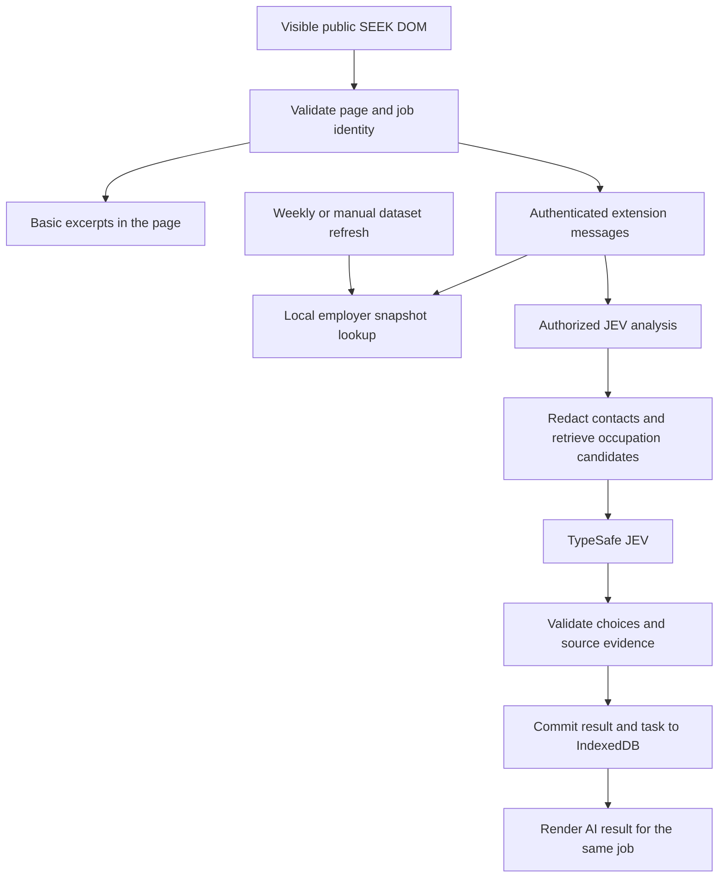

# RoleHarbour

[](https://github.com/lzh9173/roleharbour/actions/workflows/ci.yml)

A Chrome extension for researching jobs on SEEK New Zealand. View requirement excerpts and employer-list matches without an API Key; optionally add AI analysis with your own TypeSafe JEV Key.

**Version 0.21.1 · Chrome 116+ · Manifest V3**

## What it does

| Feature                                        | Without a Key                                                    | With optional JEV                                                       |
| ---------------------------------------------- | ---------------------------------------------------------------- | ----------------------------------------------------------------------- |
| Requirement and experience excerpts            | Keyword-selected quotations from the visible advertisement       | Classifies statements as required, preferred or unclear                 |
| Employer-list matching                         | Matches names against a locally stored, dated NZAEI dataset      | Same local matching                                                     |
| Occupation reference                           | —                                                                | Selects from up to eight local ANZSCO candidates, or abstains           |
| Sponsorship, work rights and residency wording | —                                                                | Summarises statements with source evidence                              |
| Inferred experience range                      | —                                                                | May estimate when no accepted explicit numeric requirement is available |
| Languages and data management                  | Five interface languages; separate job and employer-list backups | Same settings and backups                                               |

Basic excerpts appear when a complete supported job description is visible, even while AI settings load or an AI request fails. They remain in page memory and are not saved as analysis results. Successful JEV results are cached locally.

The extension has no hosted application server, RoleHarbour account, analytics, shared credential or downloaded model runtime. Supported interfaces are English, Simplified Chinese, Traditional Chinese, Japanese and Korean; job quotations retain their source language.

## Install and use

### New installation

1. Download the Chrome ZIP from [GitHub Releases](https://github.com/lzh9173/roleharbour/releases/latest), then extract it. Each release includes installation notes and SHA-256 checksums. Access to this private repository requires a GitHub account with permission.
2. Open `chrome://extensions`, enable **Developer mode**, then choose **Load unpacked** and select the extracted directory containing `manifest.json`.
3. Open a public job on `https://nz.seek.com` or `https://www.seek.co.nz`. Basic excerpts need no setup. Employer matching becomes available after the initial list download, or after importing a valid employer backup.
4. Open the extension's settings to choose a language or manage backups.

### Optional AI setup

1. Create a Key in the [TypeSafe console](https://console.typesafe.ai/keys).
2. Paste it into Settings, accept the data-transfer notice and grant the optional TypeSafe API permission. Saving a Key makes no model request.
3. On a job, accept the analysis notice and select **Analyse job**. Automatic analysis is a separate opt-in and is off by default.

Keys are session-only unless **Remember Key** is selected. Model calls and validation retries can use your TypeSafe credits.

### Upgrade an existing installation

Keep the directory Chrome already loads: `release/chrome-extension` or, for older installations, `release/roleharbour-0.11.0-chrome`. Both contain the current build; the older directory name is retained to preserve extension identity. Reload the extension in Chrome, then refresh open SEEK tabs. Do not uninstall to upgrade: uninstalling deletes extension data.

## Project structure

```text
.github/                CI, tag-triggered releases and weekly dependency updates
entrypoints/
  background.ts          Message routing, task cancellation, employer update schedule
  seek.content.ts        Content-script registration on supported SEEK pages
  sidepanel/             Settings page HTML and React entry point
src/
  core/                  Schemas, page identity, messages, analysis orchestration, extraction
  inpage/                SEEK DOM adapter, Shadow DOM mounts, basic/AI panels and badges
  providers/jev.ts       TypeSafe request construction and response/evidence validation
  rules/                 Local occupation retrieval and cache version identifiers
  employers/             Snapshot download, validation, matching, aliases and backups
  storage/               API settings, job/task IndexedDB and legacy backup schemas
  ui/                    Settings, employer controls and AI requirement presentation
  i18n/                  Five-language messages and preference synchronization
  styles/                Shared Tailwind theme
data/occupations/       Bundled ANZSCO catalogue, source metadata and keyword enrichment
public/                 Extension icons, Chrome locale metadata and attribution
scripts/                Catalogue import, icon generation, evaluation and release validation
tests/                  Application regression tests and Python release-validation tests
evaluation/             Synthetic JEV benchmark, scoring and report generation
docs/                   Development guide, privacy notice and current review record
release/                Current ZIP, checksums, install notes and stable unpacked folders
```

`wxt.config.ts` defines permissions, content security policy and build integration. `package.json` is the single source for the extension version. `.output/` and `.wxt/` are generated by WXT; `output/` holds ignored verification reports. These are not source directories.

## How it works



### 1. Read and bind the visible job

`src/inpage/seek.ts` reads supported, visible DOM nodes. It checks the page URL against the detail panel's job ID and excludes hidden content, injected controls and nested related-job cards. A home-page job dialog must identify the same job through its title and application links. Private profile and application pages are excluded.

`mount.tsx` responds to DOM mutations, navigation, visibility and language changes. It mounts React controls in closed Shadow DOM to isolate their styles from SEEK. A changed job snapshot replaces the panel and cancels its pending task. It does not crawl unopened jobs or call private SEEK APIs.

### 2. Build the basic overview locally

`BasicOverview.tsx` redacts common contact details and calls `buildRequirementCandidates` with `explicitOnly: true`. Section headings and requirement keywords select complete statements, while recognized company/benefit sections are excluded. Experience quotations appear separately and are removed from the general list to avoid duplicate display.

The basic view preserves negation and alternatives. It does not assign requirement strength, model confidence, visa conclusions or estimated years. Its extraction is bounded and can miss or include unrelated text; an empty overview does not mean the job has no requirements.

### 3. Match employers against a local snapshot

The background worker downloads the NZAEI version catalogue on first use and checks it every seven days, or on manual refresh. It validates the published date, schema, file size, row count and SHA-256 before replacing the employer database in one transaction. Failed updates keep the previous snapshot.

Names are matched locally after normalization. Curated aliases require the expected legal name and NZBN. Incomplete names and initials can produce **Needs review** candidates, with at most five displayed; they are not promoted to confirmed identity matches. Company names are not sent to the dataset service.

### 4. Run optional AI analysis

The background validates the extension sender, current tab, public page and canonical job identity before calling `analyze()`. Settings keep the Key and consent in trusted extension storage; paid dispatch rechecks authorization under a shared Web Lock.

The local retriever favors exact title and phrase matches, then scores term overlap using inverse document frequency and BM25-style saturation. This is a shortlist heuristic, not a classification confidence.

The orchestrator redacts the submitted text, retrieves up to eight candidates from the bundled 1,023-occupation ANZSCO v1.3 catalogue, checks the versioned cache and claims a persisted task. The provider creates bounded choice questions for occupation, hiring statements and requirements. It sends the title, source segments and candidate descriptions directly to TypeSafe.

Responses must pass schema, allowed-choice, probability and exact-source checks. Experience arithmetic is handled locally. The provider makes one request with a 20-second timeout; orchestration alone may retry a received `choice_not_maximum` validation error twice, after one and two seconds. Other failures and interrupted requests are not automatically resubmitted.

### 5. Store results and prevent duplicate requests

Two SHA-256 identities separate job content from its analysis interpretation. The result ID includes the content hash, provider/model, prompt, analysis, taxonomy and rules versions. Eligible cached results can be reused for 30 days; reading them does not extend their lifetime.

IndexedDB stores jobs and task state. Claiming a task prevents duplicate active work and repeated automatic submissions. A result and its completed task commit in the same transaction. Cancellation aborts uncommitted storage work; a request already sent to TypeSafe may still be processed or charged. Full job descriptions are not retained by the current page adapter, although source excerpts are saved with results.

## Develop and verify

Use the Node.js range declared in `package.json`: `^22.22.2 || ^24.15.0 || >=26.0.0`, with pnpm 11.0.6. Release validation also requires Python 3.10 or newer (standard library only).

```sh
pnpm install --frozen-lockfile
pnpm dev                              # WXT development/watch mode
pnpm typecheck
pnpm exec vitest run --maxWorkers=2
pnpm test:release                     # Packaging and version guards
pnpm eval:jev                         # Offline retrieval evaluation; no paid call
pnpm format:check
pnpm zip                              # Production build and ZIP
pnpm release:prepare                  # Verify ZIP and stage release assets
```

Build output is `.output/chrome-mv3`; the ZIP uses the package version. Publishing the build into the stable installation directories is a separate step described in [the development guide](docs/DEVELOPMENT.md).

Tests use synthetic fixtures, mocked Chrome/network boundaries and temporary IndexedDB. `eval:jev` reports candidate retrieval coverage, not AI accuracy. Live evaluation is an explicit, potentially paid command documented in [evaluation/README.md](evaluation/README.md).

## CI and releases

Pushes and pull requests to `main` run formatting, type checking, regression tests, release-validation tests, offline retrieval evaluation, a dependency audit and a production build. Verified packages and evaluation reports are retained as workflow artifacts for 14 days. CI makes no paid JEV requests and needs no API Key.

Pushing a `vMAJOR.MINOR.PATCH` tag reruns those checks and publishes a GitHub Release with `gh`: the Chrome ZIP, `INSTALL.txt` and `SHA256SUMS`. Publication requires matching tag/package/manifest versions, current changelog notes and byte-for-byte agreement between the ZIP and fresh build. It does not publish to the Chrome Web Store. See [release procedures](docs/DEVELOPMENT.md#github-actions-and-releases) and the [changelog](CHANGELOG.md).

## Limits and data handling

- A dated employer-list match does not establish current accreditation or sponsorship for a job. A missing match does not prove the employer is unaccredited.
- Occupation and visa labels describe the advertisement; they do not determine personal immigration eligibility. The catalogue contains names, aliases and hierarchy, not full official duties definitions.
- Basic extraction can omit content, and AI output can be wrong. Review the advertisement and cited evidence. An inferred experience range is not an employer-stated requirement.
- A maximum 24,000-character job description is accepted. Candidate extraction is limited to 24 skill and 12 experience statements, each at most 600 characters, with a shared 12,000-character quote budget.
- Unbookmarked stored results expire after 30 days. Historical bookmarks remain until deleted. Job backups allow 1,000 records and 5 MB; employer backups allow 12 MiB. Keys are excluded from both.
- Historical non-JEV records remain readable for validated backup import/export. They do not activate retired engines or appear as new JEV results.

Read the [privacy notice](docs/PRIVACY.md), [review record](docs/REVIEW.md), [test-data rules](tests/fixtures/README.md) and [catalogue attribution](data/occupations/README.md).

RoleHarbour is independent of SEEK, INZ and TypeSafe. It is distributed as a local installation package and has not been published to the Chrome Web Store.
