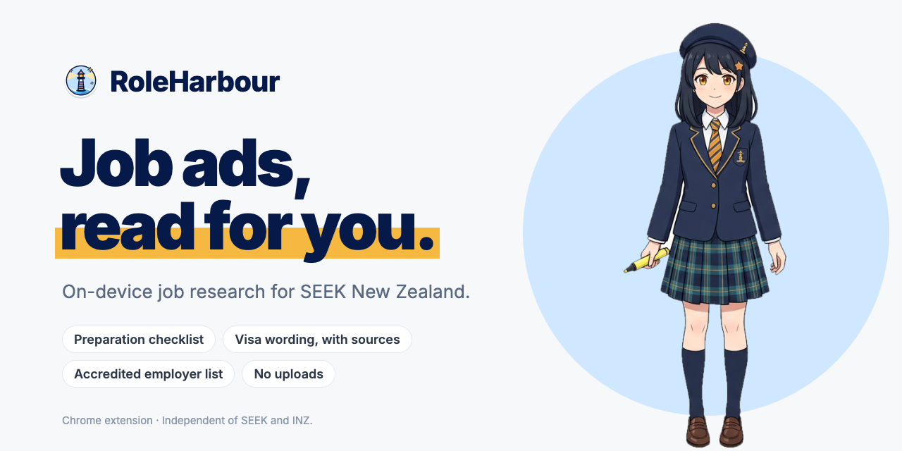
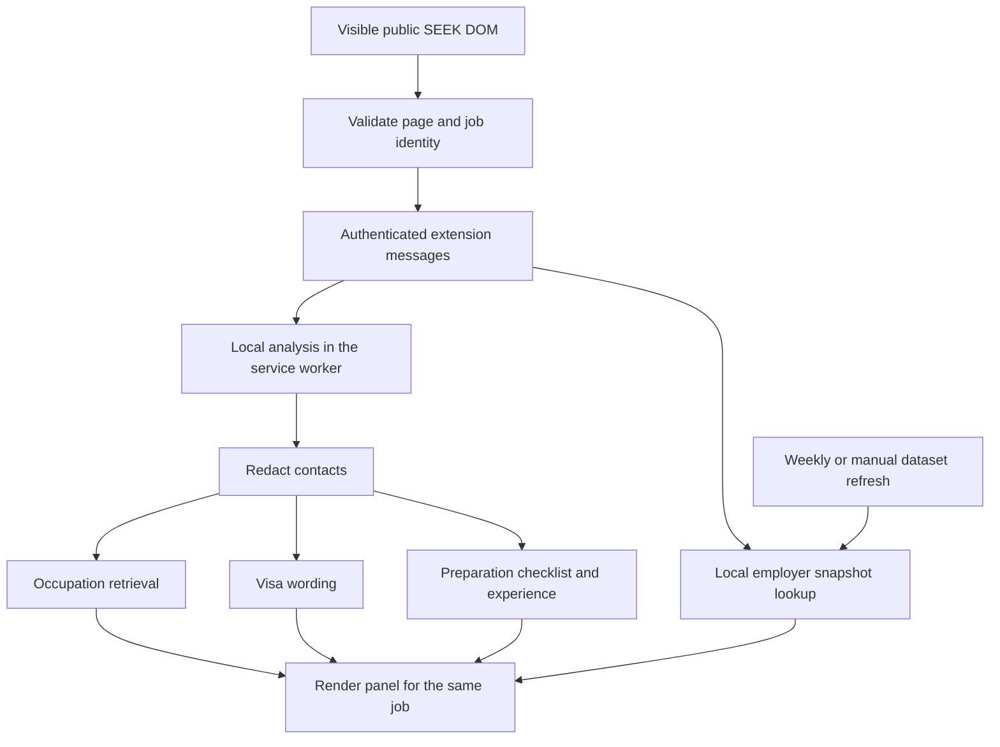

# RoleHarbour



[](https://github.com/lzh9173/roleharbour/actions/workflows/ci.yml)

A Chrome extension for researching jobs on SEEK New Zealand. Everything runs on your device: it reads the visible advertisement, keeps the source statement behind each result (shown on hover) and matches employers against a locally stored accredited-employer list. There is no account, credential or remote analysis service.

**Version 0.22.0 · Chrome 116+ · Manifest V3**

[](brand/promo/roleharbour-promo.mp4)

A 26-second tour (1080p, with sound), presented by Haru, RoleHarbour's mascot. The job ad and employer results in it are illustrative. Logo, mascot and video sources are in [`brand/`](brand/README.md).

## What it does

| Feature                   | What you see                                                                                                                                                                                                  |
| ------------------------- | ------------------------------------------------------------------------------------------------------------------------------------------------------------------------------------------------------------- |
| Occupation reference      | An ANZSCO occupation, shown only when the advertised title itself names it                                                                                                                                    |
| Experience                | Years stated in the advertisement, or a clearly labelled local estimate                                                                                                                                       |
| Accredited-employer match | The employer checked against a dated NZAEI snapshot; list pages show compact badges on job cards and a toolbar                                                                                                |
| Visa wording              | Three facts (sponsorship, existing work rights, citizen-or-resident restriction), with the source sentence on hover                                                                                           |
| Application preparation   | Programming languages, tools/platforms, knowledge areas, spoken languages, qualifications, personal qualities, application materials, nice-to-haves and other requirements, named in English as in the advert |
| Settings                  | Accredited employer list (update now, export/import backup, last checked, auto-sync failure), language, privacy and data sources                                                                              |

The panel is computed in the extension's service worker and kept in memory only; nothing about a job is saved or sent anywhere. The only network request is the public employer-list download.

Supported interfaces are English, Simplified Chinese, Traditional Chinese, Japanese and Korean; job quotations retain their source language.

## Install and use

### New installation

1. Download the Chrome ZIP from [GitHub Releases](https://github.com/lzh9173/roleharbour/releases/latest), then extract it. Each release includes installation notes and SHA-256 checksums. Access to this private repository requires a GitHub account with permission.
2. Open `chrome://extensions`, enable **Developer mode**, then choose **Load unpacked** and select the extracted directory containing `manifest.json`.
3. Open a public job on `https://nz.seek.com` or `https://www.seek.co.nz`. The panel needs no setup. Employer matching becomes available after the initial list download, or after importing a valid employer backup.
4. Open the extension's settings to choose a language or manage the employer list.

### Upgrade an existing installation

Keep the directory Chrome already loads: `release/chrome-extension` or, for older installations, `release/roleharbour-0.11.0-chrome`. Both contain the current build; the older directory name is retained to preserve extension identity. Reload the extension in Chrome, then refresh open SEEK tabs. Do not uninstall to upgrade: uninstalling deletes extension data.

Upgrading from a version with AI analysis deletes its data on first start: saved jobs and tasks, any stored API key, AI consent and automatic-analysis settings. There is no export path for saved jobs any more. The accredited employer list and language setting are kept.

## Project structure

```text
.github/                CI, tag-triggered releases and weekly dependency updates
entrypoints/
  background.ts          Message routing, local analysis, retired-data cleanup, employer update schedule
  seek.content.ts        Content-script registration on supported SEEK pages
  sidepanel/             Settings page HTML and React entry point
src/
  core/                  Schemas, page identity, messages, error helper, local-analysis entry
  local-engine/          Statement structure, requirement selection and levels, checklist, experience, visa wording
  inpage/                SEEK DOM adapter, Shadow DOM mounts, job panel, checklist and badges
  rules/                 Local occupation retrieval
  employers/             Snapshot download, validation, matching, aliases and backups
  storage/               Storage access level and retired-data cleanup
  ui/                    Settings and employer-list controls
  i18n/                  Five-language messages and preference synchronization
  styles/                Shared Tailwind theme
data/
  occupations/           Bundled ANZSCO catalogue, O*NET and NZ title synonyms, IT keywords
  skills/                O*NET software list and hand-curated checklist vocabulary
public/                 Extension icons, Chrome locale metadata and attribution
brand/                  Haru the mascot, icon source art, logo, README banner and the promo video
promo/                  Promo video source: shots, synthesised music, renderer and captured local reading
site/                   Promotional web page (React and Vite), built into output/site/
scripts/                Catalogue/vocabulary import, icon generation and release validation
tests/                  Regression tests, synthetic fixtures and Python release-validation tests
docs/                   Development guide, privacy notice, and brand and promo design notes
release/                Install notes and stable unpacked folders (ZIP and checksums are Release assets)
```

`wxt.config.ts` defines permissions, content security policy and build integration. `package.json` is the single source for the extension version. `.output/` and `.wxt/` are generated by WXT; `output/` holds ignored verification reports and promo render intermediates. These are not source directories.

## How it works



### 1. Read and bind the visible job

`src/inpage/seek.ts` reads supported, visible DOM nodes. It checks the page URL against the detail panel's job ID and excludes hidden content, injected controls and nested related-job cards. A home-page job dialog must identify the same job through its title and application links. Private profile and application pages are excluded. List items keep their bullets when the description is flattened to text, so requirement lists stay recognisable.

`mount.tsx` responds to DOM mutations (debounced, see `dom-changes.ts`), navigation, visibility and language changes. `shadow-mount.ts` mounts React controls in closed Shadow DOM to isolate their styles from SEEK, and `employer-lookup.ts` batches and caches list checks for visible employers. A changed job snapshot replaces the panel. It does not crawl unopened jobs or call private SEEK APIs.

### 2. Analyse locally

The page sends the title and description (at most 24,000 characters) to the extension's own service worker, which validates the sender, current tab and public page before calling `localAnalysis()` in `src/core/local-analysis.ts`. SEEK pages load no vocabulary or catalogue.

- **Occupation reference.** `src/rules/` retrieves candidates from the bundled 1,023-occupation ANZSCO v1.3 catalogue, favouring exact title and phrase matches, then term overlap scored with inverse document frequency and BM25-style saturation. O\*NET and project-authored NZ title synonyms match only the advertised title. A reference is shown only when the title itself names the occupation; otherwise none is shown.
- **Visa wording.** `src/local-engine/visa.ts` reads sponsorship, existing work-rights and citizen-or-resident statements, returning supported/not supported/not mentioned/conflict with the exact source sentences.
- **Preparation checklist and experience.** `src/local-engine/candidates.ts` selects requirement statements by headings and keywords, keeping negation and alternatives. `src/local-engine/requirements.ts` labels each as required, preferred or unclear and estimates an experience band when no years are stated. `src/local-engine/prep.ts` matches the statements against `data/skills/` (O\*NET 31.0 Software Skills plus hand-curated languages, NZ tools, knowledge areas, personal qualities and application materials).

Every item keeps the exact statement it came from. Results stay in memory and are recomputed for each job.

### 3. Match employers against a local snapshot

The background worker downloads the NZAEI version catalogue on first use and checks it every seven days, or on manual refresh. It validates the published date, schema, file size, row count and SHA-256 before replacing the employer database in one transaction. Failed updates keep the previous snapshot.

Names are matched locally after normalization. Curated aliases require the expected legal name and NZBN. Incomplete names and initials can produce **Needs review** candidates, with at most five displayed; they are not promoted to confirmed identity matches. Company names are not sent to the dataset service.

## Develop and verify

Use the Node.js range declared in `package.json`: `^22.22.2 || ^24.15.0 || >=26.0.0`, with pnpm 11.0.6. Release validation also requires Python 3.10 or newer (standard library only).

```sh
pnpm install --frozen-lockfile
pnpm dev                              # WXT development/watch mode
pnpm typecheck
pnpm exec vitest run --maxWorkers=2
pnpm test:release                     # Packaging and version guards
pnpm format:check
pnpm zip                              # Production build and ZIP
pnpm release:prepare                  # Verify ZIP and stage release assets
pnpm catalog:import                   # Rebuild the ANZSCO catalogue
pnpm catalog:synonyms                 # Rebuild O*NET title synonyms
pnpm catalog:software                 # Rebuild the O*NET software list
```

Build output is `.output/chrome-mv3`; the ZIP uses the package version. Publishing the build into the stable installation directories is a separate step described in [the development guide](docs/DEVELOPMENT.md).

Brand assets and the promo video are rebuilt from source; rendering needs Google Chrome and network access to Google Fonts, and the video also needs ffmpeg and Python 3 with NumPy:

```sh
node --experimental-strip-types scripts/icons.ts   # Extension icons from brand/haru/face-smile.png
node brand/scripts/render-brand.mjs                # Logo lockup and README banner
python3 -I promo/music.py output/promo/music.wav   # Promo music and sound effects
node promo/render.mjs                              # Promo video and poster into brand/promo/
```

See [`brand/README.md`](brand/README.md) and [`promo/README.md`](promo/README.md).

The promotional page in `site/` is a single static React page in English and Simplified Chinese. Its demo renders the extension's own panel components with the captured reading in `promo/data/`, and hovering a result highlights its sentence in the ad. It is built with relative URLs, so `output/site/` can be served from any path, including a GitHub Pages project site; it is not deployed yet.

```sh
pnpm site:dev                         # Development server
pnpm site:build                       # Static build into output/site/
pnpm site:preview                     # Serve the build locally
```

Tests use synthetic fixtures, mocked Chrome/network boundaries and temporary IndexedDB. The labelled synthetic dataset `tests/fixtures/role-benchmark.json` is a regression fixture for the local engine, not a measure of live accuracy.

## CI and releases

Pushes and pull requests to `main` run formatting, type checking, regression tests, release-validation tests, a dependency audit and a production build. Verified packages are retained as workflow artifacts for 14 days. CI needs no secrets.

Pushing a `vMAJOR.MINOR.PATCH` tag reruns those checks and publishes a GitHub Release with `gh`: the Chrome ZIP, `INSTALL.txt` and `SHA256SUMS`. Publication requires matching tag/package/manifest versions, current changelog notes and byte-for-byte agreement between the ZIP and fresh build. It does not publish to the Chrome Web Store. See [release procedures](docs/DEVELOPMENT.md#github-actions-and-releases) and the [changelog](CHANGELOG.md).

## Limits and data handling

- A dated employer-list match does not establish current accreditation or sponsorship for a job. A missing match does not prove the employer is unaccredited.
- Occupation and visa labels describe the advertisement; they do not determine personal immigration eligibility. The catalogue contains names, aliases and hierarchy, not full official duties definitions.
- Local extraction uses vocabulary and wording rules. It can omit or misread content; review the advertisement and quoted statements. An estimated experience band is not an employer-stated requirement, and an empty checklist does not mean the job has no requirements.
- A maximum 24,000-character job description is accepted. The checklist reads up to 120 requirement statements of at most 1,200 characters each, and says so when an advert exceeds that.
- No job data is stored. Employer backups allow 12 MiB.

Read the [privacy notice](docs/PRIVACY.md), [test-data rules](tests/fixtures/README.md), [catalogue attribution](data/occupations/README.md) and `public/occupation-sources.txt`.

RoleHarbour is independent of SEEK and INZ. It is distributed as a local installation package and has not been published to the Chrome Web Store.
